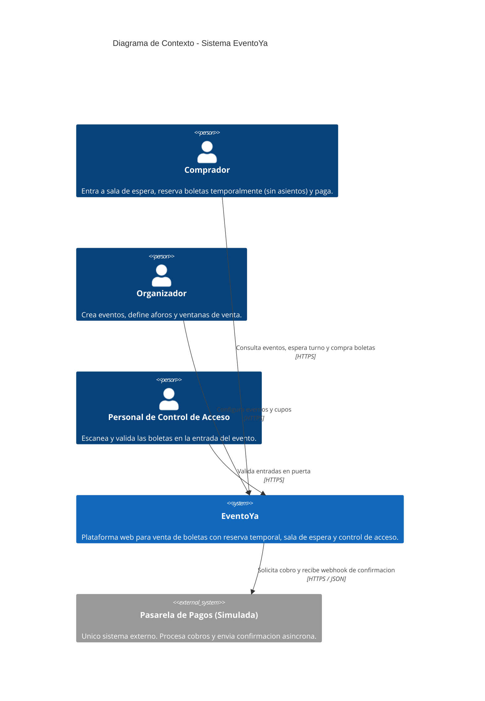

# Diagrama de Contexto (C4 - Nivel 1)

## Alcance y actores del contexto

- **Boletas sin asientos (reserva temporal):** Los compradores adquieren cupos/boletas con expiracion de tiempo mientras completan el pago; no hay mapa ni seleccion de sillas.
- **Sala de espera:** Filtra el trafico en picos de venta para que no entren todos al tiempo a descontar inventario.
- **Personal de control de acceso:** Actor operativo que consulta el sistema en puerta para verificar que la boleta sea valida y no se haya usado antes.
- **Unico sistema externo:** Solo interactua con la **pasarela de pagos simulada**.

## ¿Que pasa si la pasarela de pagos tarda 30 segundos?

1. **No se bloquea la conexion ni se cae el sistema:** El backend no deja al usuario esperando 30 segundos con la peticion abierta; registra la reserva en estado `PENDIENTE_PAGO` y responde de inmediato que el pago esta en proceso.
2. **La reserva temporal sigue protegida:** Mientras la pasarela responde (dentro de la ventana de expiracion de la reserva, definida como supuesto inicial en 5 a 10 minutos a confirmar por el equipo), esas boletas siguen apartadas para ese comprador y nadie mas las puede tomar.
3. **Confirmacion asincrona (Webhook) + Idempotencia:** Cuando la pasarela termina a los 30 segundos, envia la notificacion al webhook de EventoYa para pasar la boleta a `PAGADA` (o liberarla si fue rechazada). Si el usuario recarga o reintenta durante esos 30 segundos, la clave de idempotencia evita que se le cobre dos veces.
